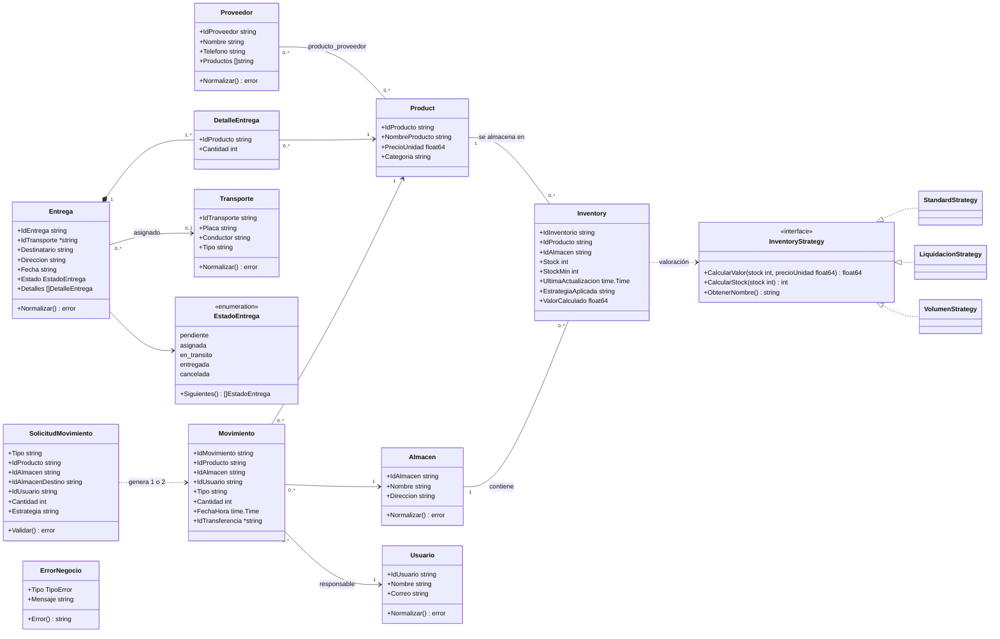
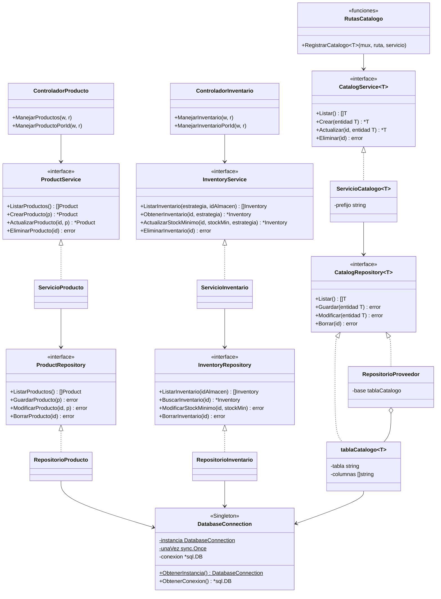
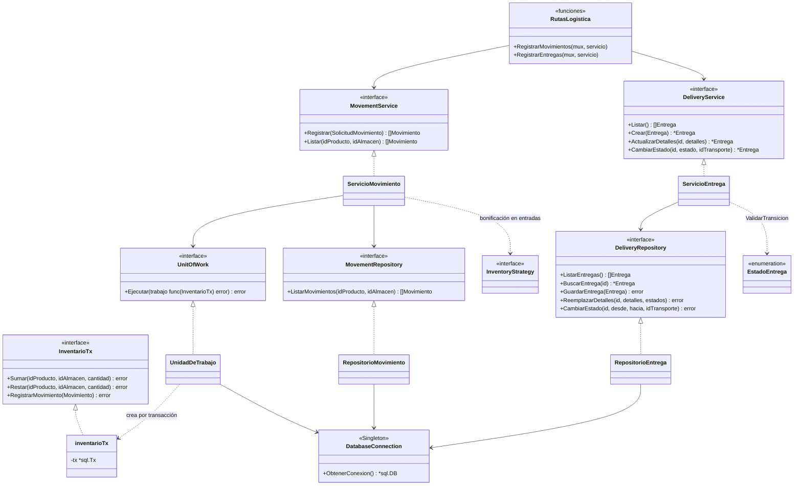

# Diagrama de clases — TiendaCocis

Los diagramas reflejan el código Go de `tienda-cocis-backend/internal`. Go no tiene clases: cada *struct* se representa como clase, cada *interface* con el estereotipo `<<interface>>` y las funciones que registran rutas con `<<funciones>>`. Los nombres de campos y métodos coinciden con el código.

Para mantener la lectura clara, el sistema se divide en tres vistas:

1. **Modelo de dominio**: entidades, Strategy y estados de entrega (State).
2. **Arquitectura hexagonal: catálogos e inventario**: Repository genérico y Singleton.
3. **Arquitectura hexagonal: movimientos y entregas**: Unit of Work y State.

En esta carpeta hay exportaciones de estos mismos diagramas: `diagrama-clases-*.png` (2×, para Word o PowerPoint) y `diagrama-clases-*.svg` (vectoriales, para navegador). Si cambias un diagrama, vuelve a exportarlo desde [mermaid.live](https://mermaid.live) o desde la vista previa de Mermaid de VS Code.

## 1. Modelo de dominio

Multiplicidades tomadas de las claves foráneas de `db/migrations/001_logistica.sql`.

Notas:

- `ValidarTransicion(actual, nuevo)` (función de `domain/delivery.go`) aplica la tabla de transiciones: pendiente → asignada | cancelada, asignada → en_transito | cancelada, en_transito → entregada.
- Una transferencia genera dos `Movimiento` (salida y entrada) con el mismo `IdTransferencia`.
- `ErrorNegocio` clasifica los errores (validación, no encontrado, conflicto) para responder 400, 404 o 409.

## 2. Arquitectura hexagonal: catálogos e inventario

`tablaCatalogo<T>` atiende usuarios, almacenes y transportes; `RepositorioProveedor` la reutiliza y además gestiona `producto_proveedor` en una transacción.

## 3. Arquitectura hexagonal: movimientos y entregas

`UnidadDeTrabajo.Ejecutar` abre una `sql.Tx`, entrega un `inventarioTx` al caso de uso, confirma si no hay error y revierte si lo hay. `Restar` solo descuenta cuando hay stock suficiente (`UPDATE … WHERE cantidad >= $n`).
